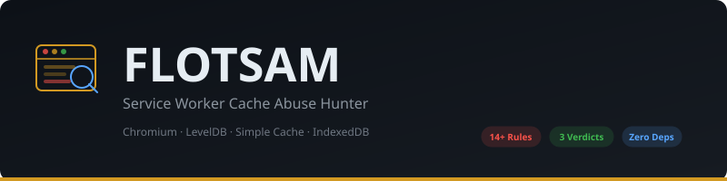

<p align="center">
  
</p>

<p align="center">
  <strong>Hunting attacker payloads in the browser's Service Worker Cache</strong>
</p>

<p align="center">
  
  
  
  
  
  
</p>

<p align="center">
  <a href="#the-problem">Problem</a> · <a href="#how-it-works">How It Works</a> · <a href="#architecture">Architecture</a> · <a href="#quick-start">Quick Start</a> · <a href="#detection-rules">Rules</a> · <a href="#demo">Demo</a> · <a href="#scope-honesty">Scope</a>
</p>

---

> *Wreck debris washes ashore long after the ship is gone. So does an attacker's
> payload — hiding in the one persistent, origin-wide, offline-capable browser
> store that incident responders almost never open: Service Worker Cache Storage.*

## The Problem

The Service Worker **Cache API** is persistent storage that survives reloads,
runs offline, and is reachable from the whole origin. Academic research has shown
it can be abused for XSS persistence, cross-origin payload staging, and fileless
malware (SecWeb 2020; ACM 2021; JSLess 2019).

But practitioners don't look there, and **no open DFIR tool triages it for abuse**.

| What exists | What it parses | Cache Storage? |
|---|---|---|
| ChromeCacheView | HTTP cache | No |
| Axiom / KAPE | HTTP cache | No |
| ccl_chromium_reader | All Chromium caches | Parses, but no abuse detection |
| **FLOTSAM** | **Service Worker Cache Storage** | **Parses + hunts for abuse** |

## How It Works

```
┌──────────────────┐     ┌──────────────────┐     ┌──────────────────┐
│  Chromium Profile │     │  Service Worker   │     │    IndexedDB     │
│  CacheStorage/    │     │  Database/        │     │  *.leveldb       │
│  (Simple Cache)   │     │  (LevelDB + proto)│     │  (LevelDB)       │
└────────┬─────────┘     └────────┬─────────┘     └────────┬─────────┘
         │                        │                        │
         ▼                        ▼                        ▼
┌──────────────────────────────────────────────────────────────────────┐
│                        FLOTSAM Engine                                │
│  ┌────────────┐  ┌────────────┐  ┌────────────┐  ┌──────────────┐  │
│  │ SimpleCache │  │  LevelDB   │  │  Protobuf  │  │   Snappy     │  │
│  │  Reader     │  │  Reader    │  │  Decoder   │  │  Decompressor│  │
│  └────────────┘  └────────────┘  └────────────┘  └──────────────┘  │
│                          │                                          │
│                 ┌────────▼────────┐                                 │
│                 │  Origin Hash    │  SHA1(<scheme>_<host>_<port>)   │
│                 │  Reversal       │  → attribute to real origin     │
│                 └────────┬────────┘                                 │
│                 ┌────────▼────────┐                                 │
│                 │  Hunt Engine    │  14+ rules × full decoded body  │
│                 │  + YARA-style   │  gzip/deflate decompression     │
│                 │  Custom Rules   │  CRC32 verification             │
│                 └────────┬────────┘                                 │
│                 ┌────────▼────────┐                                 │
│                 │  Risk Scoring   │  Weighted severity → verdict    │
│                 └─────────────────┘                                 │
└──────────────────────────────────────────────────────────────────────┘
                          │
              ┌───────────┼───────────┐
              ▼           ▼           ▼
         CLEAN     SUSPICIOUS   COMPROMISED
```

## Architecture

```
src/flotsam/
├── cli.py            # CLI: hunt, inventory, simulate, report
├── models.py         # Data models (Inventory, Finding, Verdict)
├── hunt.py           # Hunt engine: rule matching + risk scoring
├── rules.py          # Extensible YARA-style detection rules
├── extract.py        # Deep extraction from real Chromium profiles
├── simplecache.py    # Native Simple Cache format reader (zero-dep)
├── leveldb.py        # Native LevelDB reader (WAL + Snappy SSTables)
├── snappy.py         # Pure-Python Snappy block decompressor
├── proto.py          # Protobuf wire-format decoder
├── swreg.py          # Service Worker registration parser
├── indexeddb.py      # IndexedDB sibling-channel hunter
├── inventory.py      # Inventory loader + simulator
└── report.py         # Markdown/JSON report generator

tests/                # 6 test files (hunt, extract, simplecache, leveldb, e2e)
docs/
├── BSIDESSF_CFP.md   # BSidesSF 2027 talk submission
├── TALK_OUTLINE.md    # 45-minute presentation structure
└── REAL_CAPTURE.md    # Real Chrome capture methodology + results
demo/
├── victim-pwa/        # Victim PWA for live capture demo
└── attacker-server/   # Malicious SW + payload server
scripts/
└── real_capture.sh    # Drives headless Chrome → real capture → hunt
```

## Quick Start

```bash
git clone https://github.com/p17433308-cmyk/message-in-a-bottle.git
cd message-in-a-bottle
pip install -e .
```

**Run the test suite:**
```bash
pytest tests/
```

**Hunt a sample inventory:**
```bash
PYTHONPATH=src python3 -m flotsam.cli hunt --inventory samples/compromised.json
```

**Deep-extract from a real Chrome profile:**
```bash
PYTHONPATH=src python3 -m flotsam.cli inventory --deep --profile ~/Library/Application\ Support/Google/Chrome/Default
```

**Hunt with custom rules:**
```bash
PYTHONPATH=src python3 -m flotsam.cli hunt --inventory inv.json --rules my_rules.json
```

All hunting runs on extracted inventory JSON — fully reproducible offline.

## Detection Rules

| Rule | Signal | Severity |
|---|---|---|
| `active-persistence` | Cached code under origin with **active SW registration** | Critical |
| `registered-script-cached` | Cached resource **is** a registered worker script | Critical |
| `orphaned-cache` | Cache on disk but absent from CacheStorage index | High |
| `cross-origin-entry` | Response from another origin cached under victim (CDN-aware) | High |
| `dynamic-eval` | `eval()` / `new Function()` in cached script | High |
| `base64-decode` | Base64 decode calls (atob, Buffer.from) | Medium |
| `import-scripts` | `importScripts()` loading external code | Medium |
| `live-channel` | WebSocket / EventSource C2 channel | High |
| `exfil-beacon` | `navigator.sendBeacon` / fetch to external | High |
| `keylogger` | Keyboard event listeners in cached code | High |
| `formjacker` | Form data interception patterns | High |
| `crypto-miner` | Mining patterns (WebAssembly + crypto) | Medium |
| `obfuscated-body` | High-entropy text/script (packed/obfuscated) | Medium |
| `crc-mismatch` | Simple Cache CRC32 mismatch — corruption or tampering | High |
| `recently-planted` | Entry written well after cache baseline | Medium |

Verdicts: **CLEAN** · **SUSPICIOUS** · **COMPROMISED** (weighted risk score, not max severity).

## Demo

**Real Chrome capture** (needs Chrome installed):
```bash
cd demo && bash ../scripts/real_capture.sh
```
Drives headless Chrome to register a malicious Service Worker that stages
cross-origin payloads in Cache Storage, then runs FLOTSAM against the real
profile. See `docs/REAL_CAPTURE.md` for the full methodology.

**Simulate + hunt** (no browser needed):
```bash
PYTHONPATH=src python3 -m flotsam.cli simulate --out /tmp/inv.json
PYTHONPATH=src python3 -m flotsam.cli hunt --inventory /tmp/inv.json
```

## Key Technical Achievements

- **Native Simple Cache reader**: Reversed Chromium's 24-byte `SimpleFileHeader`/`SimpleFileEOF` structs, body extraction, key parsing — zero dependencies
- **Native LevelDB reader**: WAL (.log) + Snappy-compressed SSTable (.ldb) parsing, sequence-ordered, tombstone-aware — zero dependencies
- **Origin hash reversal**: `SHA1("<scheme>_<host>_<port>")` → maps opaque CacheStorage directories to real origins
- **SW registration correlation**: Protobuf-decoded `REG:` records from Service Worker Database prove **live persistence**, not just dead files

## Scope Honesty

- FLOTSAM parses structure + extracted bodies; the **abuse-detection lens** is the novel contribution, not the cache parsing itself
- Findings flag indicators for analyst review — not proof of intent on their own
- Currently targets Chromium only; Firefox/Safari parsers are future work
- Full Blink SerializedScriptValue deserialization is not implemented

## Citation

If you use FLOTSAM in forensic research:
```
FLOTSAM: Service Worker Cache Abuse-Hunting DFIR Tool
Dr. Sapna S, Prajwal Chowdary — CISFCR, PES University, Bangalore
BSidesSF 2027
```

## License

Apache-2.0. For authorized incident response, research, and education.
